<div align="center">

# X-Fly

### 在整块执行的空中视觉语言导航中，学会到达与停止

**Ruibin Ju**<sup>\*</sup> · **Ruifeng Cai** · **Min Xu** · **Lin Wang**

ARIDGE, XPENG &nbsp;·&nbsp; <sup>\*</sup>通讯作者：jurb@aridge.com

[](https://juliusju572.github.io/x-fly/zh/)
[](https://arxiv.org/pdf/2610.21450)
[](https://arxiv.org/abs/2610.21450)
[](LICENSE)

[English](README.md) · **简体中文**

</div>

<p align="center">
  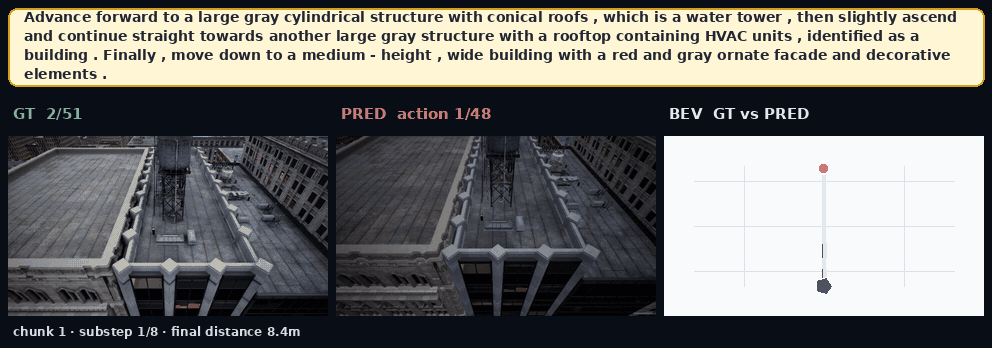
  <br><sub>留出的 UE SmallCity 航线（test-unseen）上的闭环演示：先到水塔，再到屋顶空调机组，实际飞行 140 m，停止点距目标 8.4 m。左：专家视角；中：X-Fly 视角，叠加当前 8 步控制块；右：专家 (GT) 与策略 (PRED) 轨迹俯视对比。</sub>
</p>

| SR，test-seen | SR，test-unseen | 每航点模型推理时间 |
|:---:|:---:|:---:|
| **74.18%** | **51.73%** | **195 → 42 ms**（减少 4.7×） |
| OpenFly，k = 8 | 留出的 SmallCity，k = 8 | 单步执行 → 整块执行 |

## 简介

基于大型视觉语言模型的空中视觉语言导航（VLN）智能体，每次查询都很昂贵。把预测出的整块动作执行完再重新规划，可以摊薄这一开销，把每个已执行航点的模型推理从 195 ms 降到 42 ms。但这也让策略被查询的状态偏离专家示范，而示范既不教它如何从这些状态纠偏，也不教它在自己到达时停下。在 OpenFly test-seen 上，整块执行的行为克隆（BC）有 47.78% 的结果属于“到达却未停止”的失败。

X-Fly 是面向整块执行空中 VLN 的分阶段训练框架：

1. **多域行为克隆**：在冻结的 Qwen3.5-4B 上训练快慢双路径策略，由 rectified-flow 控制器输出 8 个 4 维控制量，另有独立的 Bernoulli STOP 头。
2. **Recovery DAgger**：在学习者访问到的决策状态上，标注平滑地回到专家后续路段的 chunk，并在第一个进入目标区域的状态上标注 STOP。
3. **Flow-GRPO**：依据同任务的闭环结果，联合优化整块 flow 控制器与 Bernoulli STOP 策略，并辅以经结果验证的停止监督。

每次决策执行 8 个控制时，X-Fly 在 test-seen 上 SR 达到 74.18%，在 test-unseen 上达到 51.73%；整块执行的 BC 分别为 16.45% 与 18.43%，DreamFly 为 32.04% 与 29.46%。

<p align="center">
  <a href="https://juliusju572.github.io/x-fly/video/">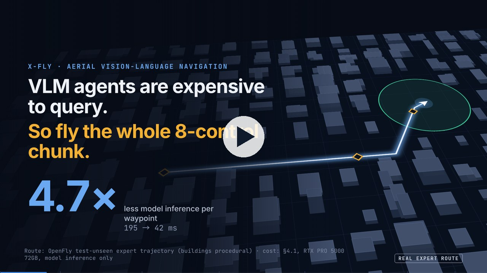</a>
  <br><sub>57 秒讲解动画，在浏览器中实时渲染（画面文字为英文）。<a href="https://juliusju572.github.io/x-fly/video/">在项目主页观看</a>。</sub>
</p>

## 方法

<p align="center">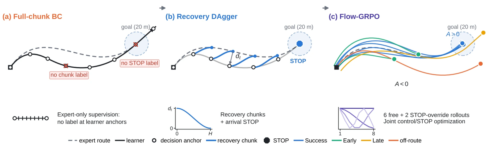</p>

**整块执行的支撑缺口。** (a) 整块执行的 BC 在两次决策之间连飞 8 步，到达专家示范覆盖很差的学习者锚点，那里既没有纠偏 chunk，也没有到达时的 STOP 标签，于是策略冲过目标。(b) Recovery DAgger 为每个学习者锚点重新标注一个 chunk：偏移按 smoothstep 衰减，在 chunk 末端回到专家路线；第一个进入区域的锚点标为 STOP。(c) Flow-GRPO 对每个任务采样 6 次自由尝试和 2 次 STOP-override 尝试，使用低频 chunk 噪声和 Bernoulli STOP 策略，并用它们的相对结果同时更新两者。

<p align="center">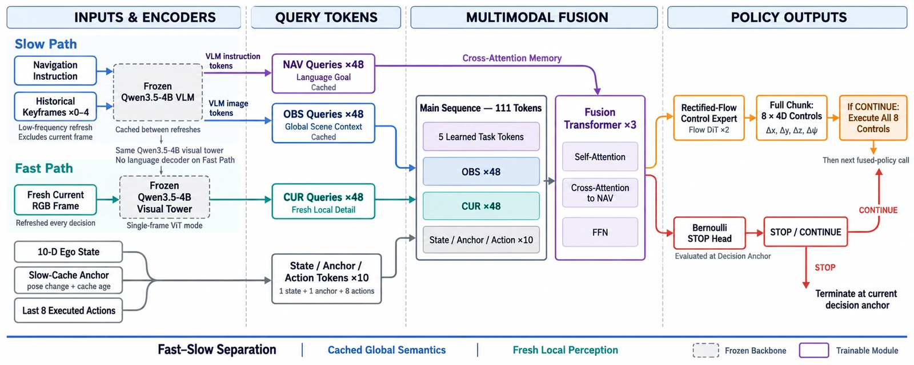</p>

**策略骨干。** 慢路径用冻结的 Qwen3.5-4B VLM 处理指令与因果关键帧；快路径只在当前帧上运行其视觉塔。融合 10 个状态/锚点/动作 token 后，表示驱动 rectified-flow 控制器输出 8 个控制量 (Δx, Δy, Δz, Δψ)，另有独立的 Bernoulli STOP 头。

## 结果

OpenFly test-seen（1,392 条轨迹）与 test-unseen（404 条，留出的 UE SmallCity），DreamFly 处理后的基准。NE 单位为米，其余为 %。所有 X-Fly 行使用单位温度 Bernoulli STOP、128 步控制上限，并在首次停止分布上精确评测；已有方法为其已发表结果，使用各自的原生停止策略。

| 方法 | k | Seen SR ↑ | Seen OSR ↑ | Seen SPL ↑ | Seen NE ↓ | Unseen SR ↑ | Unseen OSR ↑ | Unseen SPL ↑ | Unseen NE ↓ |
|:---|:---:|---:|---:|---:|---:|---:|---:|---:|---:|
| OpenFly-Agent | – | 22.63 | 52.73 | 20.42 | 122.89 | 14.11 | 62.38 | 12.49 | 163.87 |
| DreamFly | 1 | 32.04 | 46.77 | 28.22 | 44.87 | 29.46 | 46.78 | 23.54 | 45.29 |
| X-Fly BC | 1 | 46.57 | 52.85 | 39.92 | 37.28 | 22.49 | 23.46 | 21.00 | 58.61 |
| X-Fly BC | 8 | 16.45 | 67.30 | 13.54 | 37.87 | 18.43 | 43.14 | 16.18 | 48.12 |
| + Recovery DAgger | 1 | 68.88 | 75.45 | 56.84 | 20.12 | 44.27 | 47.64 | 39.96 | 36.43 |
| + Recovery DAgger | 8 | 63.46 | 72.87 | 54.54 | 21.49 | 40.63 | 52.71 | 36.46 | 35.16 |
| **+ Flow-GRPO（X-Fly 完整版）** | **8** | **74.18** | **84.07** | **66.34** | **17.77** | **51.73** | 68.07 | **47.03** | **29.17** |

节选自论文表 1；包含全部已有方法的完整表格见论文与[项目主页](https://juliusju572.github.io/x-fly/zh/#results)。unseen OSR 最高（73.02）的是 CMA。

<p align="center">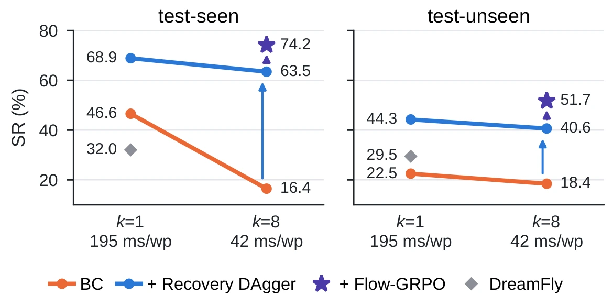 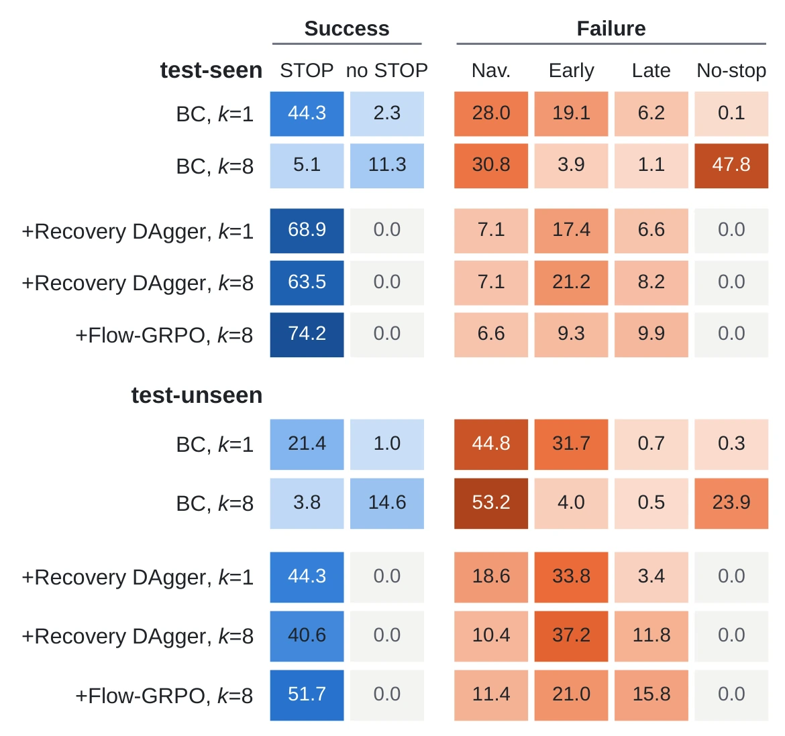</p>
<p align="center"><sub><b>左：</b>单步 (k = 1) 与整块 (k = 8) 执行下的 SR 与每航点摊销推理时间。<b>右：</b>结果归因：Recovery 消除了“未停止”失败，Flow-GRPO 让过早停止大约减半。</sub></p>

## 更多演示

<p align="center">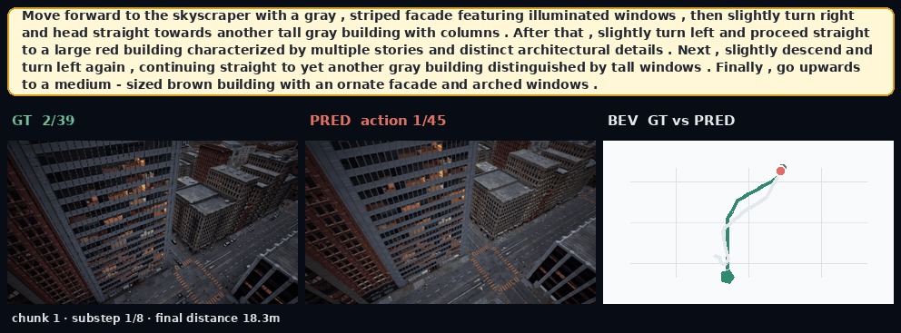
<br><sub>穿过天际线的五个地标：实际飞行 103 m，停止点距目标 18.3 m。</sub></p>

<details>
<summary><b>另外 4 条留出航线</b>（点击展开）</summary>
<br>

<p align="center">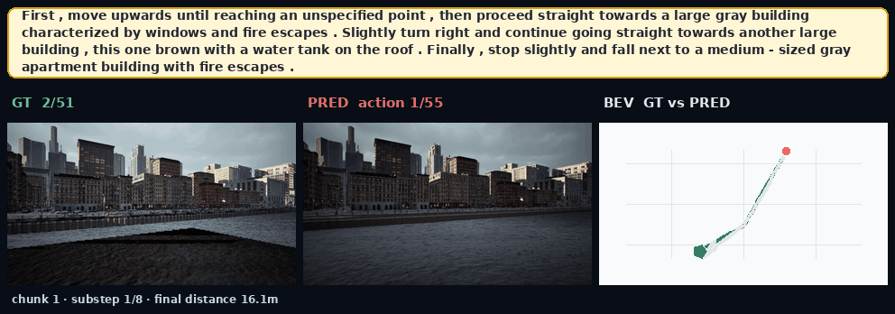
<br><sub>爬升、巡航、在目标旁下降：实际飞行 156 m，停止点距目标 16.1 m。</sub></p>

<p align="center">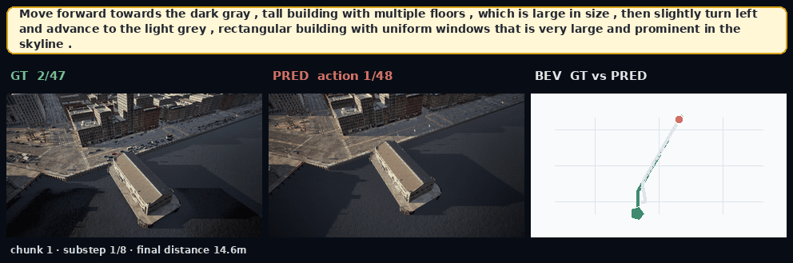
<br><sub>深色高楼、左转、浅灰楼群：实际飞行 123 m，停止点距目标 14.6 m。</sub></p>

<p align="center">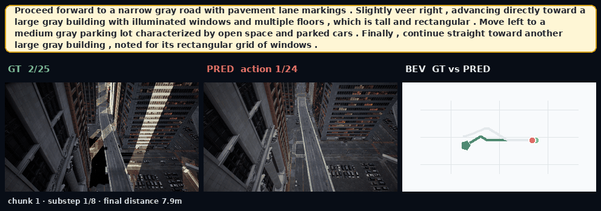
<br><sub>道路、高楼、停车场、高楼：实际飞行 67 m，停止点距目标 7.9 m。</sub></p>

<p align="center">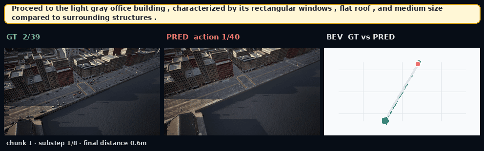
<br><sub>一句指令，实际飞行 114 m，停止点距目标 0.6 m。</sub></p>

</details>

[项目主页](https://juliusju572.github.io/x-fly/zh/#demos)以视频形式播放这些演示，并附完整指令原文，同时提供恢复标签、chunk 噪声与组内相对优势的交互式讲解。

<sub>演示为定性示例：选取实际飞行路径超过 30 m 的成功 test-unseen episode，由开发过程中的一个 Flow-GRPO checkpoint 渲染。所有基准数字均来自论文的评测协议。</sub>

## 贡献者

| 指导 · Advisor | 核心贡献者 · Core Contributor | 贡献者 · Contributors |
|:---:|:---:|:---:|
| Lin Wang | Ruibin Ju | Ruifeng Cai, Min Xu |

## 引用

```bibtex
@article{ju2026xfly,
  title   = {X-Fly: Learning to Reach and Stop in Full-Chunk Aerial Vision-Language Navigation},
  author  = {Ju, Ruibin and Cai, Ruifeng and Xu, Min and Wang, Lin},
  journal = {arXiv preprint arXiv:2610.21450},
  year    = {2026},
  url     = {https://arxiv.org/abs/2610.21450}
}
```

## 关于本仓库

本仓库存放 X-Fly 的公开项目主页与对外披露材料：网站（由 GitHub Pages 托管）、讲解动画、演示视频与论文图表；论文本身见 arXiv（[2610.21450](https://arxiv.org/abs/2610.21450)）。不包含任何训练或评测代码。网站代码以 [MIT 许可证](LICENSE) 发布；论文、图表与媒体内容 © 2026 X-Fly 作者。
